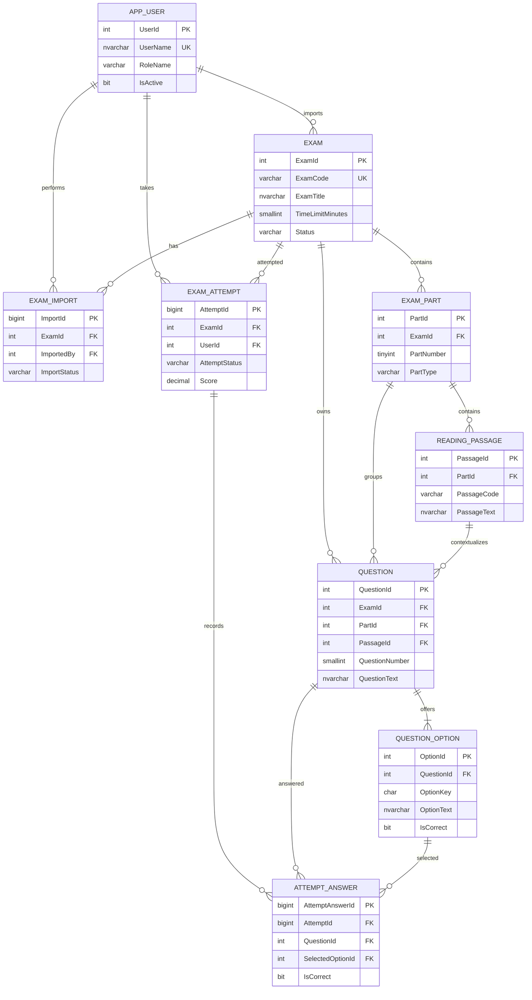

# Sơ đồ cơ sở dữ liệu TOEIC Reading

Sơ đồ dưới đây có thể chèn vào báo cáo hoặc dùng để dựng lại trên draw.io, dbdiagram.io hay SSMS Database Diagrams.

## Ý nghĩa chính

- `Exam`, `ExamPart`, `ReadingPassage`, `Question`, `QuestionOption`: lưu nội dung đề theo đúng cấu trúc Part 5, 6 và 7.
- `ExamImport`: lưu lịch sử import và lỗi validation; chỉ tạo `Exam` hoàn chỉnh khi file Word hợp lệ.
- `ExamAttempt`, `AttemptAnswer`: lưu bài làm tạm thời, bài đã nộp và kết quả chấm.
- `IsCorrect` chỉ được dùng ở dữ liệu đáp án của đề; `IsCorrect` trong `AttemptAnswer` là kết quả chấm tại thời điểm nộp bài.
